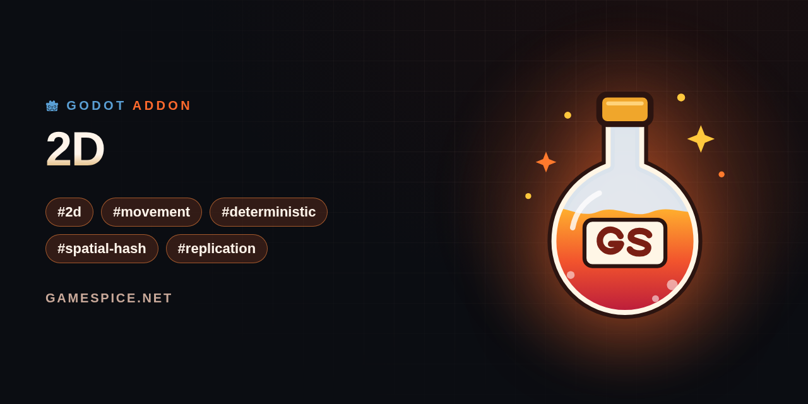

[](https://moddingcommunity.com/a/28-gs-2d)

Deterministic 2D movement and world code for Godot 4, for games seen from above. It is the 2D counterpart of [GameSpice Player Controller](https://github.com/gamespice-platform/player-controller) and part of the [GameSpice](https://github.com/gamespice-platform) family. It needs [GameSpice Core](https://github.com/gamespice-platform/core) and nothing else.

This is a GameSpice addon, MIT licensed and built with Claude Code. Its headless self-test (`res://examples/gs_2d_selftest.tscn`) runs offline. The code is in use: the games in [Zee's Games](https://zeesgames.com) are built on the GameSpice addons and run on live servers, and this is the 2D movement under one of them.

It gives you three movement feels (top-down, thrust, and mass-based blob), a spatial hash for fast neighbour queries, seeded pellet fields, and `Vector2` replication specs. [game-hungario](https://github.com/zees-games/game-hungario) is built on it.

## Install

1. Copy `addons/gs_2d/`, `addons/gs_core/` and `addons/gs_camera/` into your project.
2. Enable all three in *Project > Project Settings > Plugins*.

## Use

```gdscript
var world := GS2DArena.new()
world.bounds = Rect2(Vector2(-2000, -2000), Vector2(4000, 4000))
add_child(world)

var player := GS2DController.new()
player.tunables = GS2DTunables.blob()
add_child(player)
player.attach(world, session_id)

# Once per simulated tick, on client and server alike.
player.simulate_tick(tick, 1.0 / 60.0)
world.sync_grid()

# Who can this blob eat?
for id in world.overlapping(state.position, state.radius, my_id):
    ...
```

## How it works

The simulation is a pure function of a `GS2DCommand`: no device, no clock, no node, no randomness. A client predicting a move, a server re-running it and a reconciliation replay all reach the same position.

The sampler turns the pointer into a direction and a world-space distance before the command is sent. A screen position means nothing on a server that has no window or camera.

## Classes

| Class | What it does |
| --- | --- |
| `GS2DCommand` | What a player asked for, sanitised against hostile input. |
| `GS2DState` | Position, velocity, facing, radius and mass. Can be snapshotted and replayed. |
| `GS2DTunables` | How the entity moves: top-down, thrust or blob. |
| `GS2DMassRules` | How mass becomes size, speed and the right to eat. |
| `GS2DMotor` | The simulation itself. Pure and node-free. |
| `GS2DAdminModifiers` | Admin noclip, freeze and speed step, carried in the state so the owning client predicts them. |
| `GS2DBody` | Collision. `Flat` is for a bounded rectangle, `Physics` for everything else. |
| `GS2DGrid` | A uniform spatial hash for local queries. |
| `GS2DScatter` | Pellet fields laid out from a seed and refilled on a per-tick budget. |
| `GS2DArena` | The world: bounds, grid, interest rectangles and spawn positions. |
| `GS2DController` | Drives one entity, local, commanded or remote. |
| `GS2DSampler` | Turns devices into commands. The only place input is read. |
| `GS2DCameraRig` | Follows the entity, zooms with size and stays inside the world. |
| `GS2DNetSync` | What to replicate, without naming a GameSpice Net type. |

## Mass rules

`GS2DMassRules` keeps the three blob relationships in one place so they agree. These are the defaults and can be changed in the rules resource.

| Rule | Default |
| --- | --- |
| Radius | Grows with mass^0.5, so two small blobs equal one big one by area. |
| Speed | Falls with mass^-0.44, down to a floor so the biggest blob never stops. |
| Eating | Needs both a mass ratio and an overlap. `can_eat` checks both in one call. |

## Collision backends

`GS2DBodyFlat` is the one to use in production. It is analytic, and a client and a server get bit-identical answers. A physics query depends on solver state from earlier steps, so it cannot promise that. `GS2DBodyPhysics` is for unpredicted entities and single-player games.

## Limits

| Setting | Default | Meaning |
| --- | --- | --- |
| `GS2DMassRules.max_pieces` | 16 | Most pieces one player may have; 0 = unlimited, negative is refused by `validate()`. |

## Test

```bash
godot --headless --path . --import
godot --headless --path . res://examples/gs_2d_selftest.tscn
```

The self-test runs offline and exits non-zero on any failure.

## Used by

The only game that vendors it, because it is the one seen from above.

- [Hungario](https://zeesgames.com/hungario) - movement, the spatial grid and the pellet fields

The whole collection is at [zeesgames.com](https://zeesgames.com).

## Licence

MIT. See [LICENSE](LICENSE). Only the TMC back-end web infrastructure is not open source; if you use your own back end instead of TMC's, you build that part yourself.
